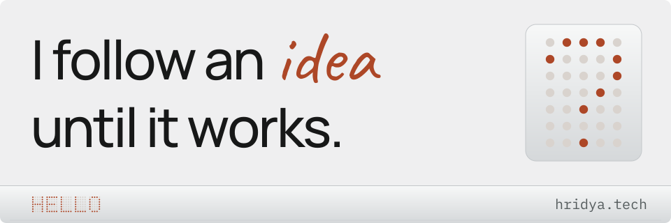

# [Hridya Agrawal](https://hridya.tech)

<a href="https://hridya.tech">
  <picture>
    <source media="(prefers-color-scheme: dark) and (max-width: 600px)" srcset="./assets/hero-mobile-dark.svg">
    <source media="(max-width: 600px)" srcset="./assets/hero-mobile-light.svg">
    <source media="(prefers-color-scheme: dark)" srcset="./assets/hero-dark.svg">
    
  </picture>
</a>

**Software, games, and a few things in between.** Based in London. I build tools for problems I run into.

[Portfolio](https://hridya.tech) · [LinkedIn](https://www.linkedin.com/in/hridya-agrawal-067236317/) · [X](https://x.com/AgrawalHridaya)

## What if?

### My terminal understood plain English?

**[Lexis](https://lexis.hridya.tech)** turns a request into shell commands with a local llama.cpp model. A rule engine checks the risk; you approve before anything runs.

[Explore Lexis ↗](https://lexis.hridya.tech) · [Read the source](https://github.com/hridaya423/lexis)

### A launcher did more with less?

**[Foundry](https://foundry.hridya.tech)** is a native macOS launcher for apps, clipboard history, file transforms, window layouts, and AI chat.

[Explore Foundry ↗](https://foundry.hridya.tech) · [Read the source](https://github.com/hridaya423/foundry)

### A circuit board could cut its own launch film?

**[silk reel](https://silkreel.hridya.tech)** turns a KiCad board file into a product film, built from its actual copper, parts, and silkscreen. Export MP4, GIF, WebM, or ProRes with alpha.

[Try the studio ↗](https://silkreel.hridya.tech/studio) · [Read the source](https://github.com/hridaya423/silkreel)

### HTML video spent less time rendering?

**[Strobe](https://github.com/hridaya423/strobe)** renders existing Remotion and HyperFrames projects with a Rust engine that keeps frames on the GPU from paint to encoder.

[Source, releases, and benchmarks ↗](https://github.com/hridaya423/strobe)

### Revision started with real exam questions?

**[Revise with the Past](https://revise.hridya.tech)** builds GCSE practice papers from real past questions for the topics you need, then marks your answers.

[Make a practice paper ↗](https://revise.hridya.tech) · [Read the source](https://github.com/hridaya423/revisewiththepast)

Also: **[Cue](https://github.com/hridaya423/cue)**, a macOS clipboard that pastes the part that fits the field, and **[Neurix](https://github.com/hridaya423/neurix)**, an early block-programming environment with 3D, physics, and audio.

## Out in the world

- **1st place · Reinvent the Wheel, October 2026.** Co-built **[Locus](https://github.com/hridaya423/locus)** with a team to find public omics datasets and generate nf-core samplesheets.
- **White Circle track winner · 2nd overall · Moonfire Build Night, October 2026.** Built **[Fineprint](https://github.com/hridaya423/fineprint)**, a small model that flags risky terms-of-service clauses on your own laptop.
- **Shanghai → Tokyo, 2025.** Built **[Undead Courier](https://undeadcourier.hridya.tech)** for Juice and **[Whisper](https://github.com/hridaya423/whisper)** for Shiba, then brought them to a pop-up café and an arcade machine.

<strong>A little more about me</strong>

- **Silver Suits AI · AI Engineer · April 2026–present.** I build autonomous voice agents for banking and finance.
- **Shawbrook Bank · Work experience · July 2026.** I built and containerised a mortgage calculator.
- **Hack Club · Volunteer · August 2025–present.** I review projects and orders for fraud and handle bans and appeals.
- **Seven certification exams before twelve; two more at thirteen.** Microsoft, Pega, Oracle, and GitHub. [View and verify the credentials on my portfolio](https://hridya.tech/#achievements).

---

**Have an idea worth following?** [Say hello at hridya.tech ↗](https://hridya.tech)
