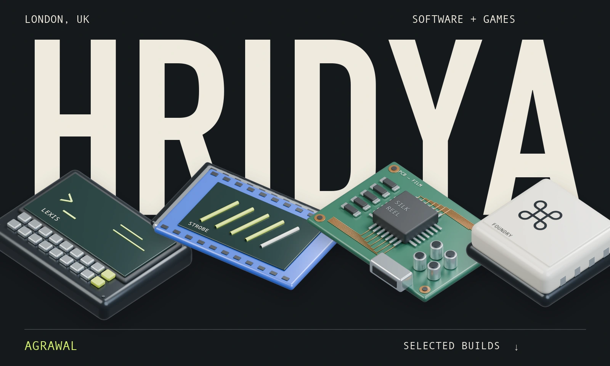
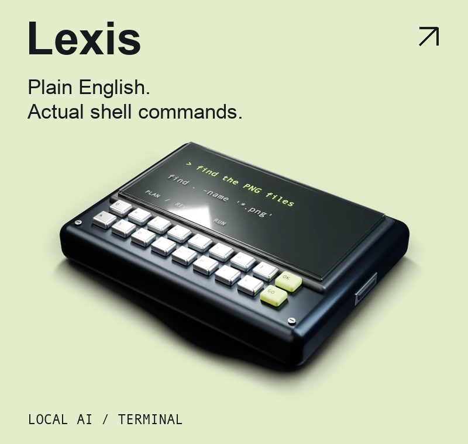
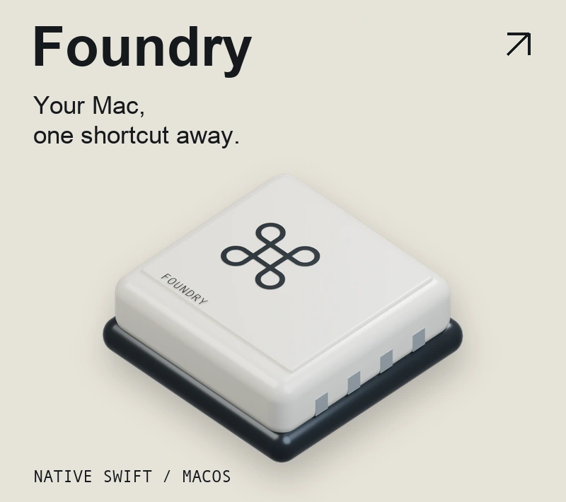
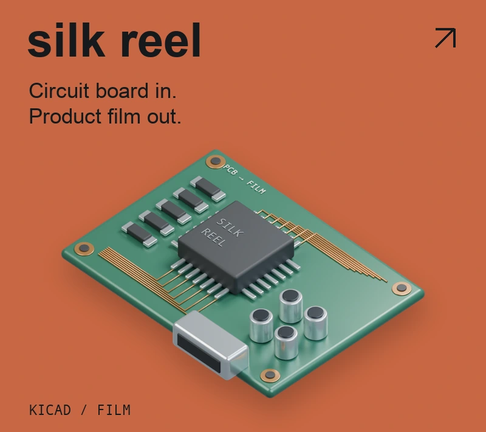
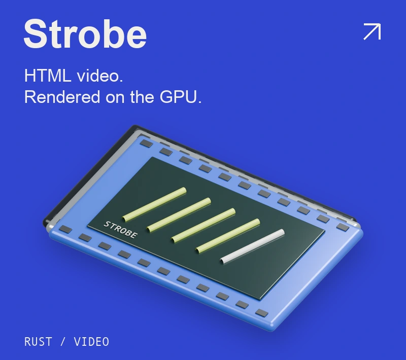

<a href="https://hridya.tech">
  <picture>
    <source media="(max-width: 600px)" srcset="./assets/workbench-mobile.webp">
    
  </picture>
</a>

**I build tools for problems I run into.** A shell that understands me. A faster video renderer. A game that ends up in an arcade.

[My website ↗](https://hridya.tech) &nbsp; / &nbsp; [LinkedIn](https://www.linkedin.com/in/hridya-agrawal-067236317/) &nbsp; / &nbsp; [X](https://x.com/AgrawalHridaya)

## Pick something up

  
  

  
  

<strong>Project links &amp; technical notes</strong>

| Project | What it does | Try it |
| :--- | :--- | :--- |
| [Lexis](https://github.com/hridaya423/lexis) | A local llama.cpp model plans shell commands. A rule engine checks risk; you approve execution. | [Install](https://lexis.hridya.tech) |
| [Foundry](https://github.com/hridaya423/foundry) | Native Swift tools for apps, clipboard history, file transforms, window layouts, and AI chat. | [Download](https://foundry.hridya.tech) |
| [silk reel](https://github.com/hridaya423/silkreel) | Render a board's copper, components, and silkscreen as MP4, GIF, WebM, or ProRes with alpha. | [Open studio](https://silkreel.hridya.tech/studio) |
| [Strobe](https://github.com/hridaya423/strobe) | Render existing Remotion and HyperFrames projects while keeping frames on the GPU from paint to encoder. | [Releases](https://github.com/hridaya423/strobe/releases) |

**More from the bench:** [Revise with the Past](https://revise.hridya.tech), GCSE practice from real exam questions · [Cue](https://github.com/hridaya423/cue), a clipboard that picks the right part · [Neurix](https://github.com/hridaya423/neurix), an early block-programming environment.

## Some builds leave the laptop

**London · science &amp; small models**

[Locus](https://github.com/hridaya423/locus) won **1st at Reinvent the Wheel** in October 2026. I built it with a team to find public omics datasets and generate nf-core samplesheets. [Fineprint](https://github.com/hridaya423/fineprint), a local model for risky terms-of-service clauses, won the **White Circle track and 2nd overall** at Moonfire Build Night.

**Shanghai → Tokyo · games in the real world**

I made [Undead Courier](https://undeadcourier.hridya.tech) for Juice and showed it at a pop-up gaming café in Shanghai. For Shiba, I made [Whisper](https://github.com/hridaya423/whisper), then built an arcade machine for it in Tokyo.

<strong>The short backstory</strong>

I work on voice agents for banking and finance at **Silver Suits AI**, volunteer at **Hack Club**, and built a mortgage calculator during work experience at **Shawbrook Bank**.

I passed seven certification exams before twelve and two more at thirteen. [The credentials and their verification links are on my website.](https://hridya.tech/#achievements)

---

**The source is here. The rest is at [hridya.tech ↗](https://hridya.tech).**
