<a href="https://www.hridya.tech">hridya.tech</a> &nbsp;·&nbsp; <a href="https://x.com/AgrawalHridaya">x</a> &nbsp;·&nbsp; <a href="https://www.linkedin.com/in/hridya-agrawal-067236317/">linkedin</a>

### things i made

- [lexis](https://github.com/hridaya423/lexis): plain english to shell commands, run by a local model, approved by you
- [foundry](https://github.com/hridaya423/foundry): a native mac launcher with clipboard history, file transforms and windows
- [silk reel](https://github.com/hridaya423/silkreel): put a kicad board in, get a product film out
- [cue](https://github.com/hridaya423/cue): a mac clipboard that pastes only the part the field wants
- [strobe](https://github.com/hridaya423/strobe): renders remotion and hyperframes video on the gpu, in rust

### lately

- [locus](https://github.com/hridaya423/locus) won 1st at reinvent the wheel
- [fineprint](https://github.com/hridaya423/fineprint) won the white circle track and 2nd overall at moonfire build night
- [whisper](https://github.com/hridaya423/whisper) got its own arcade machine in tokyo
